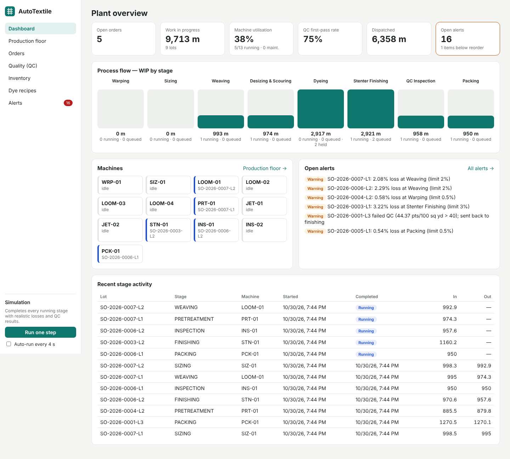
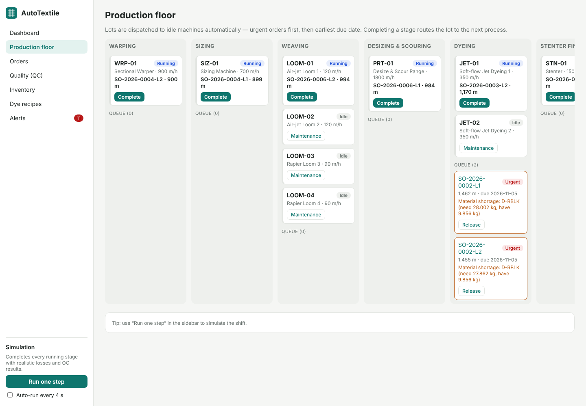

# AutoTextile — Textile Process Automation

Order-to-dispatch production automation for a woven-fabric mill. It plans lots, schedules machines,
issues dyes and chemicals, runs 4-point QC, and raises alerts, all from one local app.

```
Warping → Sizing → Weaving → Desizing & Scouring → Dyeing → Stenter Finishing → QC Inspection → Packing → Dispatch
```



## What the automation engine does

| Rule | Behaviour |
|---|---|
| **Lot planning** | A new order is split into lots of up to 1,500 m and queued at warping. |
| **Auto-scheduling** | Whenever a machine is free, it picks the next queued lot for its stage: urgent priority first, then earliest due date, then FIFO. |
| **Routing** | Completing a stage moves the lot to the next process. Undyed orders skip dyeing. |
| **Dye-house issue** | When a lot starts dyeing, recipe quantities are calculated (`% owf` from fabric weight, `g/L` from liquor ratio) and deducted from stock. |
| **Shortage hold** | If any dye or chemical is short, the lot is held and a critical alert is raised. Receiving stock releases held lots automatically. |
| **Process loss** | Loss above each stage's limit (e.g. 2 % at dyeing) raises an alert. |
| **4-point QC** | Points per 100 sq yd = points × 3600 ÷ (yards × width in inches). ≤ 40 passes to packing; the first failure goes back to finishing for rework; a second failure rejects the lot. |
| **Due-date risk** | Every 15 s, remaining machine-hours are compared with the time left; at-risk and overdue orders are flagged. |
| **Low stock** | Items at or below reorder level raise an alert. |
| **Order closure** | An order completes when all of its lots are dispatched or rejected. |

## Screens

Dashboard (KPIs, WIP by stage, machines, alerts) · Production floor (machine and queue board per stage) ·
Orders and order detail (lot progress, process history, losses) · QC inspection entry with live pass/fail ·
Inventory with goods receipt · Dye recipes and batch consumption calculator · Alerts.

The sidebar has a **simulation** that completes every running stage with realistic losses and defects,
so you can watch the plant run a shift.



## Run locally

Requires **Node.js 22.13 or newer** (it uses Node's built-in SQLite, so there's no database to install).

```bash
git clone https://github.com/deva-0909/autotextile.git
cd autotextile
npm install
npm run dev
```

Open http://localhost:5173. The API runs on http://localhost:4000. On first start the database
(`server/data/textile.db`) is created and loaded with demo machines, stock, recipes and orders.

| Command | Purpose |
|---|---|
| `npm run dev` | API + UI with hot reload |
| `npm run build && npm start` | Production build served from one port (http://localhost:4000) |
| `npm test` | Automation-engine tests |
| `npm run seed` | Reset the database to fresh demo data |
| `npm run typecheck` | Type-check server and client |

Environment variables (optional): `PORT` (default 4000), `DB_FILE`, `AUTOMATION_INTERVAL_MS` (default 15000).

> Node prints `ExperimentalWarning: SQLite is an experimental feature` on start. It is harmless.

## Project layout

```
server/            Express API (TypeScript, run with tsx)
  src/automation.ts  scheduling, routing, dye issue, QC routing, alerts, simulation
  src/stages.ts      process route and loss limits
  src/qc.ts          4-point inspection maths
  src/recipes.ts     dye recipe consumption
  src/app.ts         REST endpoints (/api/...)
  src/seed.ts        demo data
  test/              node:test suite
client/            React + Vite UI
```

## API overview

`GET /api/dashboard` · `GET|POST /api/orders` · `GET /api/orders/:id` · `GET /api/lots?stage=&status=` ·
`POST /api/lots/:id/complete {output_m}` · `POST /api/lots/:id/inspection {defects:[{type,points,count}], inspector}` ·
`POST /api/lots/:id/{dispatch|hold|release}` · `GET /api/machines` · `PATCH /api/machines/:id {status}` ·
`GET /api/inventory` · `POST /api/inventory/:id/receive {qty}` · `GET|POST /api/recipes` ·
`GET /api/recipes/:shade/consumption?quantity_m=&width_cm=&gsm=` · `GET /api/alerts` · `POST /api/alerts/:id/ack` ·
`POST /api/automation/run` · `POST /api/simulation/step`
